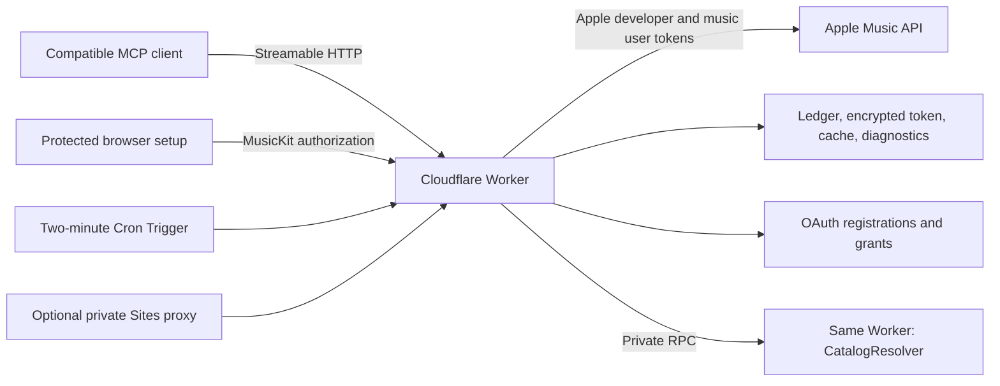

# Apple Music MCP

A self-hosted [Model Context Protocol](https://modelcontextprotocol.io/) server that lets compatible AI assistants use your Apple Music account and query a listening-history database you control.

Run it on **Cloudflare Workers with D1 and KV**. It does not need a computer left on, a Cloudflare Tunnel, or an AI provider API key. Each installation connects one Apple Music account; every authorized client gets the same 14 tools. You supply your own Apple credentials and music authorization.

## Features

- **Library and discovery:** search the catalog, browse playlists and their tracks, and get personalized recommendations and heavy rotation.
- **Official Apple Music Replay:** request the latest eligible year's summary and top content directly from Apple.
- **Playlist creation and appending:** resolve up to 100 catalog IDs or song name/artist pairs in one request, preview matches, reject ambiguity, and skip duplicates.
- **Observed listening history:** collect Apple's current recently played window every two minutes, preserve events and distinct raw payload versions in D1, and query history with pagination.
- **Timeframe analytics:** summaries and rankings for tracks, artists, albums, and genres; rolling, calendar, and exact custom ranges.
- **Remote client options:** Streamable HTTP with a bearer key, MCP OAuth, or a private capability URL that needs no extra password.
- **Reliable collection:** shared leases, transactional snapshot updates, empty-window protection, overlap diagnostics, and persistent Apple rate-limit cooldowns.
- **Efficient operation:** daily indexed maintenance, cached developer tokens and catalog searches, bounded private catalog RPC, and lazy MCP initialization.
- **Optional ChatGPT Sites compatibility:** keep an owner-private Sites plugin as a thin proxy to the Cloudflare backend, or use the separate Sites deployment mode.

Playlist changes are limited to creating an empty playlist and appending tracks. Removal, replacement, reordering, deletion, artwork changes, and metadata editing are not exposed.

## How it works



The browser setup flow obtains a Music User Token. The server encrypts it with AES-GCM before storing it in D1, and signs short-lived ES256 developer tokens with your Apple private key. The collector compares successive recently played windows and commits new events and the new snapshot together.

**Observed history is approximate.** Apple returns at most 30 recent tracks and no exact play timestamps. Collection cannot backfill old activity or guarantee complete coverage. Use Replay for Apple's official rankings; account-wide plays/minutes are available only when Apple explicitly supplies them. See [history and operations](docs/operations.md).

## Requirements

- Node.js **22.18+** and npm.
- A Cloudflare account with Workers, D1, and KV access.
- An Apple Developer Program account able to create Media IDs and Media Services keys.
- An active Apple Music subscription for the account being connected.
- An AI client with **remote Streamable HTTP MCP** support. Merely accepting web links does not make a client MCP-capable.

Cloudflare's free allowances can support personal use, but request, CPU, database, KV, and storage limits still apply. Apple subscriptions and any AI-client charges are separate. This project does not enable a paid Cloudflare plan. See [cost and maintenance](docs/operations.md#cost-and-maintenance).

## Part 1: Create Apple credentials

In [Apple Certificates, Identifiers & Profiles](https://developer.apple.com/account/resources/identifiers/list):

1. Create a **Media ID**, give it your own description and reverse-domain identifier, and enable its MusicKit/Apple Music service.
2. Create a **Media Services** private key and associate it with that Media ID.
3. Download the `.p8` file while Apple makes it available, and record the key ID and developer team ID.

Keep the complete private key, including its PEM header and footer. Never commit it. Refer to [Apple's Media ID/key instructions](https://developer.apple.com/help/account/capabilities/create-a-media-identifier-and-private-key/) if the portal's labels change.

## Part 2: Deploy to Cloudflare

### 1. Install

Clone this repository using its GitHub **Code** button, then run:

```sh
cd apple-music-mcp
npm ci
cp wrangler.example.toml wrangler.toml
npx wrangler login
npx wrangler whoami
```

`wrangler.toml` is your private deployment configuration and is ignored by Git. Choose your own Worker name if necessary. If you change its top-level `name`, change `services[0].service` to the same value: the `CATALOG_RESOLVER` binding points to the same Worker's `CatalogResolver` entrypoint. Keep that binding for large song-resolution batches.

### 2. Create storage

```sh
npx wrangler kv namespace create OAUTH_KV
npx wrangler d1 create apple-music-mcp
```

Copy the returned KV ID and database ID into the matching placeholders in `wrangler.toml`. If you choose a different database name, update `database_name` and the database arguments in the following commands. These are your resources; the repository includes no production account IDs.

### 3. Set secrets

Generate four independent random values using a password manager or run `openssl rand -base64 32` four times. Store them as:

| Secret | Purpose |
| --- | --- |
| `MCP_API_KEY` | Shared all-tools bearer key; also the default source of the private capability URL. Use at least 32 random characters. |
| `SETUP_TOKEN` | Passcode for the protected Apple Music setup page. |
| `OAUTH_CONSENT_TOKEN` | Passcode for approving MCP OAuth clients. |
| `TOKEN_ENCRYPTION_KEY` | Encrypts the stored Music User Token. Retain it with private backups. |
| `APPLE_TEAM_ID` | Your developer team ID. |
| `APPLE_KEY_ID` | Your Media Services key ID. |
| `APPLE_PRIVATE_KEY` | Complete contents of your `.p8` file. |

Enter values interactively, rather than putting them in command arguments or shell history:

```sh
npx wrangler secret put MCP_API_KEY
npx wrangler secret put SETUP_TOKEN
npx wrangler secret put OAUTH_CONSENT_TOKEN
npx wrangler secret put TOKEN_ENCRYPTION_KEY
npx wrangler secret put APPLE_TEAM_ID
npx wrangler secret put APPLE_KEY_ID
npx wrangler secret put APPLE_PRIVATE_KEY
```

`POKE_MCP_API_KEY` is an optional legacy override for deriving the capability URL. Its name does not limit it to Poke. New installations can omit it and use `MCP_API_KEY`. Setup and encryption secrets serve different purposes; they are not credentials you give an AI client.

### 4. Apply migrations, validate, deploy

```sh
npx wrangler d1 migrations list apple-music-mcp --remote
npx wrangler d1 migrations apply apple-music-mcp --remote
npm test
npm run typecheck
npx wrangler deploy --dry-run
npm run deploy
```

Apply **all** migrations before running the new code. They create the encrypted-token/configuration tables, listening ledger and payload versions, diagnostic/audit tables, fenced collector controls, maintenance indexes, migration archives, and catalog cache.

The example config enables one `*/2 * * * *` Cron Trigger and a private catalog resolver binding. No separate helper Worker or Tunnel is needed. Keep `SITE_COLLECTOR_URL` unset for standalone Cloudflare operation.

### 5. Authorize Apple Music

Open your deployed Worker's clean setup URL:

```text
https://YOUR_WORKER.YOUR_SUBDOMAIN.workers.dev/setup
```

Enter `SETUP_TOKEN`, select **Authorize Apple Music**, complete Apple's prompt, and wait for **Apple Music connected**. The passcode travels in a POST body and establishes a ten-minute HttpOnly setup session; do not add it to the URL.

The Music User Token may eventually expire. Apple supplies no refresh-token flow for it; return to `/setup` and authorize again when necessary, retaining the existing history and encryption key.

### 6. Connect your AI client

All three options grant the **same 14 tools** against the one connected account. There are no separate read-only roles.

| Option | MCP URL | Authentication |
| --- | --- | --- |
| Shared bearer | `https://YOUR_WORKER.YOUR_SUBDOMAIN.workers.dev/mcp` | `Authorization: Bearer <MCP_API_KEY>` |
| Private capability URL | `https://YOUR_WORKER.YOUR_SUBDOMAIN.workers.dev/mcp/<CAPABILITY_TOKEN>` | None beyond possession of the URL. |
| MCP OAuth | `https://YOUR_WORKER.YOUR_SUBDOMAIN.workers.dev/mcp` | Client's OAuth flow; approve with `OAUTH_CONSENT_TOKEN`. |

**Bearer configuration** (adapt field names to your client):

```json
{
  "name": "Apple Music",
  "url": "https://YOUR_WORKER.YOUR_SUBDOMAIN.workers.dev/mcp",
  "transport": "streamable-http",
  "headers": { "Authorization": "Bearer <MCP_API_KEY>" }
}
```

**Private URL configuration:** generate the connection locally from your existing key:

```sh
node scripts/mcp-connection.mjs https://YOUR_WORKER.YOUR_SUBDOMAIN.workers.dev
```

The helper asks for the key without echoing it and saves private settings in ignored `work/mcp-connection.json`. Use `POKE_MCP_API_KEY` if your deployment sets that override; otherwise use `MCP_API_KEY`. The capability token is the lowercase SHA-256 digest of that key, not the raw key and not a new independent credential. The same capability token can instead be supplied as `Authorization: Bearer <CAPABILITY_TOKEN>` at `/mcp`.

Treat the entire capability URL as a credential. The example configuration disables invocation URL logging; keep it disabled when using this mode. Credential vaults that substitute secrets only in headers should use the bearer option rather than embedding a vault placeholder in the URL. Some clients automatically select OAuth even for a capability URL; use their explicit API-key/bearer mode in that case.

**OAuth configuration:** add the `/mcp` URL to a client implementing MCP OAuth discovery. Check the client name on the browser consent screen, enter `OAUTH_CONSENT_TOKEN`, and return to the client. The server uses S256 PKCE, one-hour access tokens, 30-day refresh tokens, and the `apple_music` scope.

Examples for [Poke, custom connector clients, and Sites compatibility](docs/clients.md) explain the different connection flows. A plain browser GET to `/mcp` is not an MCP test: this is a stateless POST transport, and GET/DELETE are not used for sessions or streams.

### 7. Verify

Discover tools and confirm that the client sees **14**. Call `apple_music_status`; it should report credentials configured and connected. Call `apple_music_analytics_status` and observe at least two actual scheduled successes about two minutes apart. Check the latest successful poll and any cooldown; a configured cron or manual refresh alone does not establish automatic collection.

For playlist verification, start with `dryRun: true`. A real create or append changes the library, so only request one when you intend that change. Never automatically repeat an uncertain write.

## Tools

| Tool | Purpose / main inputs |
| --- | --- |
| `apple_music_status` | Connection, credentials, token update time, storefront. |
| `apple_music_recently_played` | Bounded observed history: timeframe, `limit`, `cursor`, `refreshFirst`. |
| `apple_music_heavy_rotation` | Apple's heavy rotation; `limit` up to 10. |
| `apple_music_recommendations` | Personalized recommendation groups; `limit` up to 10. |
| `apple_music_replay_summary` | Official latest eligible year rankings, catalog-enriched songs, and explicit totals availability. |
| `apple_music_list_playlists` | Library playlists and editability; `limit` up to 500. |
| `apple_music_get_playlist_tracks` | Playlist tracks: `playlistId`, `limit` up to 500. |
| `apple_music_search_catalog` | Catalog search: `term`, `types`, `limit` up to 25. |
| `apple_music_create_playlist` | Create an empty playlist: `name`, optional `description`. |
| `apple_music_add_tracks_to_playlist` | Resolve/preview/deduplicate/append: `playlistId`, up to 100 `tracks`, `dryRun`, `allowPartial`. |
| `apple_music_analytics_refresh` | Refresh the complete available recent window, up to 30 tracks. |
| `apple_music_analytics_status` | Ledger coverage, recent attempts, overlap/failure diagnostics, cooldown. |
| `apple_music_listening_summary` | Observed totals and top categories for a timeframe. |
| `apple_music_top_stats` | Rank tracks/artists/albums/genres: timeframe, `kind`, `limit`. |

### Playlist example

After obtaining an editable playlist's ID, preview an entire batch in one call:

```json
{
  "playlistId": "<YOUR_LIBRARY_PLAYLIST_ID>",
  "tracks": [
    { "name": "<SONG_TITLE>", "artist": "<ARTIST_NAME>" },
    { "id": "<APPLE_CATALOG_SONG_ID>" }
  ],
  "dryRun": true,
  "allowPartial": false
}
```

Inspect unresolved and ambiguous matches before changing `dryRun` to `false`. With `allowPartial=false`, any unresolved or ambiguous item blocks the entire append. Duplicates already in the playlist or repeated in the request are skipped. POST writes are never retried automatically; an uncertain outcome returns verification information and `doNotRetry` when appropriate. A successful Apple response can still precede visible propagation to library reads.

### Timeframes

Presets: `today`, `24h`, `7d`, `30d`, `90d`, `ytd`, `last_year`, `all_time`.

```json
{ "preset": "30d", "limit": 20, "refreshFirst": false }
```

Or provide an inclusive `start` and optional exclusive `end`, with explicit UTC/offset timestamps and no preset:

```json
{
  "start": "2026-01-01T00:00:00Z",
  "end": "2026-02-01T00:00:00Z",
  "timeZone": "Etc/UTC",
  "limit": 50
}
```

Calendar presets default to `America/Denver`; pass your own IANA `timeZone` as needed. Reuse a returned `timeframe.asOf` as the optional `asOf` input on other preset queries to keep their bounds aligned. Use exact start/end without `asOf` for custom ranges. The ledger remains live, so this does not freeze the database. For pagination, keep the same timeframe and use the returned `nextCursor` while `hasMore=true`. Custom ranges, SQL aggregation, and estimated timestamps all refer to the observed ledger, not complete Apple playback records.

### Replay and ranking details

Replay preserves Apple’s ranking order and fills missing song names, artists, and links through bounded catalog-ID lookups. `songMetadata` and per-song `metadataStatus` disclose missing/unavailable metadata without inventing a match. `totalsAvailable=false` means the response contains no account-wide listening totals; an album’s catalog track count is not a play count. `rankingInfo` reports the different returned list lengths, and `coverage.periodState` identifies current-year rankings that can change.

Observed rankings expose `name` consistently while retaining the legacy `key`. Album IDs and links use valid recorded Apple Music album URLs or catalog lookups from archived song catalog IDs, with album/artist checks; unavailable or mismatched references are not fabricated. Heavy Rotation preserves Apple’s resource order and can contain playlists or albums without ranks or play counts; use observed top stats for measured rankings.

## Local development

```sh
npm ci
cp .dev.vars.example .dev.vars
# Fill .dev.vars with your own local secrets.
npm run db:migrate:local
npm run dev:local
```

The checked-in `wrangler.local.toml` uses simulated D1/KV and a resolver binding to the local Worker. Open `http://127.0.0.1:8787/setup`, authorize Apple Music, and connect an MCP client to `/mcp` with the local bearer key. Keep the server bound locally.

Wrangler does not fire Cron Triggers automatically during local development. For one collection pass while it is running:

```sh
curl -fsS 'http://127.0.0.1:8787/__scheduled?cron=%2A%2F2+%2A+%2A+%2A+%2A'
```

Continuous local collection needs a host scheduler and a running computer. Local history and authorization persist under `.wrangler/state`; back them up before resetting local state. `npm run build` builds the **Sites** bundle, whereas `npm run deploy` deploys the **Cloudflare** Worker.

## Updates, operations, and privacy

- [Operations, limits, troubleshooting, and backup/rollback](docs/operations.md).
- [Client connection examples and private Sites proxy](docs/clients.md).
- [Update an existing checkout](docs/mac-handoff.md).
- [Separate private Sites deployment and migration](docs/sites-migration.md).
- [Cloudflare timer for a Sites-owned database](docs/sites-timer-bridge.md).

Apply pending D1 migrations before deploying new code. Preserve existing database/KV bindings and the encryption key. Keep exactly one authoritative collector during any migration; transferring the latest data is required before rolling back to an older database.

This repository contains reusable source, placeholder configuration, schema migrations, and synthetic tests. **Do not publish** live capability URLs, keys, Apple authorization, listening data, database dumps, logs, screenshots, owner identities, production configuration, or private migration reports. The ignore rules exclude the usual local locations; review the staged tree and Git history before sharing. Ignoring a file does not remove a previously committed copy.

## Project layout

| Path | Contents |
| --- | --- |
| `src/index.ts` | Cloudflare authentication/routes, Cron, private `CatalogResolver` entrypoint. |
| `src/mcp.ts`, `src/mcp-http.ts` | 14 tool schemas/handlers and bounded stateless HTTP transport. |
| `src/apple.ts`, `src/apple-transport.ts` | Apple API, token/catalog caching, matching batches, retries/timeouts. |
| `src/analytics.ts`, `src/recent-history.ts`, `src/timeframe.ts` | Ledger collection, snapshots, history pages, SQL analytics. |
| `src/collector-control.ts` | Fenced leases, persisted cooldowns, daily maintenance gate. |
| `src/setup*.ts`, `src/storage.ts`, `src/crypto.ts` | Protected authorization and encrypted token storage. |
| `src/capability-access.ts` | Shared capability URL and equivalent bearer authentication. |
| `src/sites*.ts`, `src/site-forward.ts` | Optional Sites entrypoint, migration/service routes, timer, proxy. |
| `migrations/` | Ordered Cloudflare D1 migrations. |
| `db/`, `drizzle/` | Separate Sites schema and generated migrations. |
| `scripts/mcp-connection.mjs` | Private local connection-settings helper. |
| `test/` | Synthetic protocol, history, concurrency, matching, transport, and safety tests. |
| `wrangler.example.toml`, `.dev.vars.example` | Placeholder setup templates. |

## References

- [Apple developer tokens](https://developer.apple.com/documentation/applemusicapi/generating-developer-tokens)
- [Apple recently played tracks](https://developer.apple.com/documentation/applemusicapi/get-v1-me-recent-played-tracks)
- [Cloudflare D1 migrations](https://developers.cloudflare.com/d1/reference/migrations/)
- [Cloudflare Worker secrets](https://developers.cloudflare.com/workers/configuration/secrets/)
- [Cloudflare service-binding RPC](https://developers.cloudflare.com/workers/runtime-apis/bindings/service-bindings/rpc/)
- [Cloudflare Workers limits](https://developers.cloudflare.com/workers/platform/limits/)
- [MCP Streamable HTTP](https://modelcontextprotocol.io/specification/2025-06-18/basic/transports)
